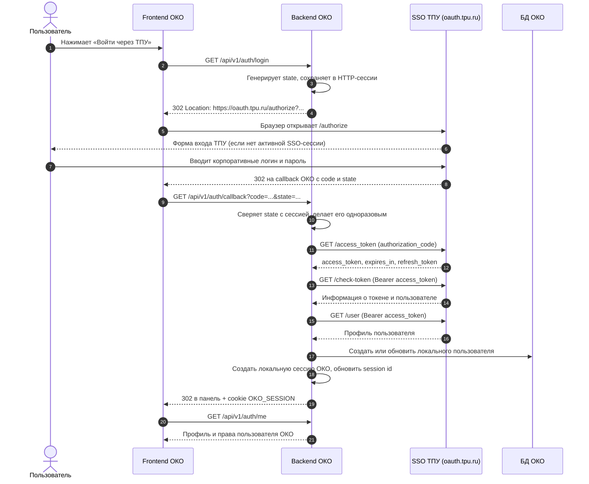

# Единая авторизация ТПУ: руководство для backend и OpenAPI

**Проект:** ОКО ТПУ  
**Для кого:** backend-разработчик, аналитик, QA  
**Проверено по документации ТПУ:** 12.11.2026  
**Статус:** техническое руководство по интеграции; параметры, которые документация ТПУ не фиксирует однозначно, отдельно помечены как требующие подтверждения.

---

## 1. Кратко: что мы интегрируем

ОКО использует единую авторизацию ТПУ как OAuth-клиент. Пользователь входит на стороне ТПУ, а ОКО получает подтверждённую личность и создаёт **собственную локальную сессию**.

Главное правило: **логин и пароль пользователя ТПУ никогда не отправляются в ОКО**. Браузер пользователя перенаправляется на `oauth.tpu.ru`, пользователь проходит вход там, после чего ТПУ возвращает браузер в ОКО с одноразовым `code` и исходным `state`.

Для ОКО нужен пользовательский сценарий **Authorization Code** и персональный токен (`type = personal`). Системный токен (`type = system`) не является заменой авторизации конкретного студента или сотрудника.

### Две группы endpoint'ов

1. **Внутренние endpoint'ы ОКО** — frontend вызывает их на нашем backend. Они уже предусмотрены в проекте.
2. **Внешние endpoint'ы ТПУ** — вызываются браузером пользователя или backend-сервисом ОКО на `https://oauth.tpu.ru`. Это не маршруты, которые нужно реализовывать в Spring Boot ОКО; их нужно описать в OpenAPI как внешний сервис и реализовать вызовы к ним в `IdentityProvider`.

В OpenAPI у ОКО базовый server — `/api/v1`. Для внешних операций ТПУ необходимо переопределить `servers` на `https://oauth.tpu.ru`, иначе Swagger будет ошибочно считать их маршрутами ОКО.

---

## 2. Общая схема взаимодействия



Примечания к схеме:

- Возврат на callback выполняется через браузер пользователя. Обмен `code` на токен — серверный запрос backend ОКО → ТПУ.
- `check-token` и `user` вызываются backend'ом. Access token не должен попадать во frontend.
- После входа frontend работает с локальной cookie-сессией ОКО. Для просмотра панели не нужно при каждом запросе повторно обращаться в SSO ТПУ.
- Если для MVP токен ТПУ нужен только чтобы один раз получить профиль, его можно не сохранять после завершения обмена и проверки. Если позднее ОКО будет вызывать другие API ТПУ, токены следует хранить только на сервере и реализовать refresh.

---

## 3. Какие endpoint'ы должны быть описаны в OpenAPI

### 3.1. Внутренние endpoint'ы ОКО

Все пути ниже указаны относительно `servers: /api/v1`.

| Метод и путь | Кто вызывает | Назначение | Статус в текущем проекте |
|---|---|---|---|
| `GET /auth/login` | Frontend / браузер | Начать вход: создать `state` и перенаправить браузер на ТПУ | Уже есть в `AuthController` и OpenAPI |
| `GET /auth/callback` | Браузер после редиректа ТПУ | Принять `code` и `state`, проверить `state`, завершить OAuth-вход и создать локальную сессию | Уже есть в `AuthController` и OpenAPI |
| `GET /auth/me` | Frontend | Вернуть текущего пользователя и его права в ОКО | Уже есть в `AuthController` и OpenAPI |
| `POST /auth/logout` | Frontend | Завершить локальную сессию ОКО | Уже есть в `AuthController` и OpenAPI |

Это **наши** endpoint'ы. Не нужно создавать второй набор `/api/v1/tpu/...` только потому, что внешние вызовы идут в ТПУ.

`/auth/password-login` и dev-заглушка — временные/служебные способы входа проекта, а не часть SSO-протокола ТПУ.

### 3.2. Внешние endpoint'ы ТПУ

Для всех внешних операций базовый адрес:

```text
https://oauth.tpu.ru
```

| Метод и путь | Кто вызывает | Назначение | Обязательность для ОКО |
|---|---|---|---|
| `GET /authorize` | Браузер пользователя (через redirect) | Начать авторизацию, получить `code` | Обязателен |
| `GET /access_token` с `grant_type=authorization_code` | Backend ОКО | Обменять одноразовый `code` на токены | Обязателен |
| `GET /check-token` | Backend ОКО | Проверить токен и получить тип токена / ID пользователя | Предусмотрен основным процессом ТПУ; использовать для проверки `personal` |
| `GET /user` | Backend ОКО | Получить профиль пользователя | Обязателен для получения ФИО, логина и email |
| `GET /access_token` с `grant_type=refresh_token` | Backend ОКО | Обновить access token по refresh token | Опционален для MVP, если токен нужен только на время входа |
| `GET /auth/logout` | Браузер пользователя (через redirect) | Завершить глобальную SSO-сессию ТПУ | Нужен, если кнопка «Выйти» должна завершать и SSO-сессию ТПУ |

В OpenAPI `/access_token` должен быть **одной операцией** с разными наборами параметров в зависимости от `grant_type`. Не надо заводить два одинаковых пути `/access_token`.

Для `check-token` и `user` указывается `security: Bearer`. Для `authorize`, `access_token` и `auth/logout` OAuth Bearer не используется: они принимают query-параметры или запускаются редиректом.

### 3.3. Схемы данных, которые стоит описать

Минимальный набор `components/schemas`:

- `TpuTokenResponse` — `access_token`, `expires_in`, `refresh_token`.
- `TpuTokenCheckResponse` — `message`, `body`.
- `TpuTokenInfo` — `created`, `expired`, `client_id`, `type`, `user_id`, `lichnost_id`, `username`.
- `TpuUserProfile` — `user_id`, `lichnost_id`, `login`, `full_name`, `first_name`, `last_name`, `patronymic`, `email`, `elements`, `message`.

Точные форматы ошибок внешнего SSO в опубликованной инструкции не стандартизированы. В OpenAPI лучше описать общий `default` response с пояснением, что формат ошибки требуется подтвердить у ТПУ, а не придумывать конкретные поля.

---

## 4. Подробно по каждому внешнему endpoint'у

### 4.1. `GET https://oauth.tpu.ru/authorize`

**Назначение:** начать авторизацию пользователя ТПУ. Этот адрес открывает браузер, а не backend через WebClient/RestTemplate.

Параметры query:

| Параметр | Обязателен | Описание |
|---|---:|---|
| `client_id` | Да | Идентификатор OAuth-приложения ОКО из настроек ТПУ |
| `redirect_uri` | Да | Полный callback URL ОКО, зарегистрированный в приложении ТПУ |
| `response_type` | Да | Для нашего сценария — `code` |
| `state` | Да | Случайное одноразовое значение для защиты от CSRF |

Пример (значения условные):

```text
https://oauth.tpu.ru/authorize?client_id=OKO_CLIENT_ID&redirect_uri=https%3A%2F%2Foko.example.ru%2Fapi%2Fv1%2Fauth%2Fcallback&response_type=code&state=RANDOM_ONE_TIME_VALUE
```

Ожидаемое поведение:

1. Если у пользователя нет активной SSO-сессии, ТПУ предлагает ввести корпоративные логин и пароль.
2. Если пользователь уже авторизован в ТПУ, повторный ввод пароля может не потребоваться.
3. После успешной авторизации браузер перенаправляется на `redirect_uri` с `code` и исходным `state`.

Важно:

- Домен и callback URL должны быть внесены в доверенные настройки приложения ТПУ.
- `state` генерируется backend'ом ОКО криптографически случайным, сохраняется в серверной сессии и проверяется на callback.
- Не используем implicit/client-side flow с access token во фрагменте URL: ОКО — серверное приложение.
- PKCE: в настройках OAuth ТПУ есть настройка, связанная с отключением PKCE. Если PKCE будет включён/обязателен, нужно согласовать с ТПУ точные параметры (`code_challenge`, `code_challenge_method`, `code_verifier`) и дополнить OpenAPI. Текущая пошаговая инструкция ТПУ эти параметры не описывает, поэтому не следует считать поддержку подтверждённой без теста.

### 4.2. Внутренний callback ОКО: `GET /api/v1/auth/callback`

Это не endpoint ТПУ. Сюда браузер приходит после редиректа с `/authorize`.

Query-параметры:

| Параметр | Обязателен | Описание |
|---|---:|---|
| `code` | Да | Одноразовый код авторизации, выданный ТПУ |
| `state` | Да | Значение, которое ОКО отправлял в `/authorize` |

Что должен сделать backend:

1. Найти HTTP-сессию, в которой начинался вход.
2. Сравнить полученный `state` с сохранённым значением. Сравнение — constant-time.
3. Отклонить запрос при отсутствии сессии, отсутствии `state` или несовпадении значений. В этом случае не выполнять запрос к `/access_token`.
4. Удалить `state` из сессии после проверки, чтобы не использовать его повторно.
5. Обменять `code` на токен, проверить токен и получить профиль пользователя.
6. Создать/обновить локальную запись пользователя ОКО.
7. Создать локальную сессию ОКО и вернуть пользователя в разрешённый `returnTo`.

В текущем `AuthController` уже есть проверка `state`, очистка атрибутов входа и вызов `IdentityProvider.exchange(code, callbackUri)`. Реализация внешних запросов должна находиться внутри реализации `IdentityProvider`, а не в frontend.

Callback должен быть защищён от open redirect: разрешать только относительный внутренний `returnTo` или заранее заданный allowlist. Не перенаправлять пользователя на произвольный URL из query.

### 4.3. `GET https://oauth.tpu.ru/access_token` — обмен `code`

**Назначение:** backend ОКО обменивает одноразовый код на токены. Это сервер-сервер запрос.

Параметры query для пользовательского входа:

| Параметр | Обязателен | Значение |
|---|---:|---|
| `client_id` | Да | OAuth client ID ОКО |
| `client_secret` | Да | Секрет OAuth-приложения ОКО |
| `grant_type` | Да | `authorization_code` |
| `code` | Да | Одноразовый код, полученный callback'ом |
| `state` | Да | Тот же `state`, что был отправлен на `/authorize` |
| `redirect_uri` | Да | Должен совпадать с `redirect_uri` из `/authorize` |

Пример (не использовать реальные секреты в документации или логах):

```text
GET https://oauth.tpu.ru/access_token?client_id=...&client_secret=...&grant_type=authorization_code&code=...&state=...&redirect_uri=...
```

Ожидаемый ответ по документации:

```json
{
  "access_token": "<secret>",
  "expires_in": 86400,
  "refresh_token": "<secret>"
}
```

`expires_in` — время жизни access token в секундах. Использовать нужно фактическое значение из ответа, а не жёстко прошитые 24 часа. Документация указывает срок жизни refresh token около одной недели.

**Критически важно по безопасности:** основной процесс ТПУ сейчас документирует `GET`, поэтому `client_secret`, `code` и другие секретные значения оказываются в query string. Это риск утечки через access logs, reverse proxy, APM, tracing и логи HTTP-клиента.

- Не логировать полный URL запроса к `/access_token`.
- Маскировать `client_secret`, `code`, `access_token`, `refresh_token` и другие чувствительные query-параметры во всех инфраструктурных логах.
- Не включать подробный wire/debug logging HTTP-клиента в production.
- Не передавать эти значения frontend.
- Отдельно спросить поддержку ТПУ, принимает ли endpoint `POST` с параметрами в теле. Вводное описание сервиса упоминает POST для обмена code, но актуальная пошаговая инструкция и инструкция обновления указывают GET. Самостоятельно менять метод на POST без проверки нельзя.

### 4.4. `GET https://oauth.tpu.ru/check-token`

**Назначение:** проверить выданный access token. Токен передаётся в HTTP-заголовке, не в query.

Заголовок:

```http
Authorization: Bearer <access_token>
```

Пример успешного ответа по документации:

```json
{
  "message": "Valid",
  "body": {
    "created": "2025-07-21 09:32:26",
    "expired": "2025-07-22 09:32:26",
    "client_id": "my-app-id-123456",
    "type": "personal",
    "user_id": 123,
    "lichnost_id": 123,
    "username": "portal_login"
  }
}
```

Backend должен проверить:

- ответ означает, что токен действителен;
- `client_id` соответствует приложению ОКО, если это поле возвращается;
- `type` равен `personal` для сценария входа человека;
- присутствует идентификатор пользователя (`user_id` и/или `lichnost_id`) и логин.

Если `type = system`, не считать это авторизацией конкретного человека и не создавать пользовательскую сессию ОКО.

### 4.5. `GET https://oauth.tpu.ru/user`

**Назначение:** получить профиль пользователя по access token.

Заголовок:

```http
Authorization: Bearer <access_token>
```

Пример ответа по документации:

```json
{
  "user_id": 59568,
  "lichnost_id": 745454,
  "elements": {
    "familiya": "Иванов",
    "imya": "Иван",
    "otchestvo": "Иванович"
  },
  "full_name": "Иванов Иван Иванович",
  "last_name": "Иванов",
  "first_name": "Иван",
  "patronymic": "Иванович",
  "email": "login@tpu.ru",
  "login": "login",
  "message": "OK"
}
```

Для текущей панели ОКО достаточно получить как минимум:

- `login` — логин для локальной учётной записи и настройки администраторов;
- `full_name` — отображаемое имя;
- `email` — email, если он возвращается;
- `user_id` и `lichnost_id` — идентификаторы ТПУ; рекомендуется не терять их, если их планируется использовать для устойчивой связи с учётной записью или для будущих функций.

В опубликованном примере `/user` **нет** явного поля роли (студент/сотрудник), учебной группы, института или подразделения. Не выводить статус пользователя из адреса email или логина. Если эти данные нужны продукту, запросить у ТПУ отдельные scope/методы и права.

Текущая модель проекта `ExternalIdentity` содержит только `login`, `fullName`, `email`, а `LoginService` обновляет пользователя по `login`. Если идентификаторы `user_id` или `lichnost_id` должны стать устойчивым внешним ключом, нужно расширить DTO, `app_user` и миграцию БД. До этого следует подтвердить у ТПУ, какой ID стабилен при смене логина и может ли один `lichnost_id` иметь несколько `user_id`.

### 4.6. `GET https://oauth.tpu.ru/access_token` — обновление токена

**Назначение:** получить новый access token без повторного ввода пользователем логина и пароля.

Используется тот же endpoint `/access_token`, но другой `grant_type` и другой набор параметров:

| Параметр | Обязателен | Значение |
|---|---:|---|
| `client_id` | Да | OAuth client ID ОКО |
| `client_secret` | Да | OAuth secret ОКО |
| `grant_type` | Да | `refresh_token` |
| `refresh_token` | Да | Refresh token из предыдущего ответа |

Пример:

```text
GET https://oauth.tpu.ru/access_token?client_id=...&client_secret=...&grant_type=refresh_token&refresh_token=...
```

Обновление не является обязательной частью MVP ОКО, если токен ТПУ используется только для получения профиля во время входа, а затем ОКО работает со своей локальной сессией. Если backend решит хранить и повторно использовать токены ТПУ, нужно реализовать refresh до истечения `expires_in`, обновлять сохранённый refresh token при его ротации (если он возвращается) и обрабатывать отказ refresh как повод начать новый вход.

### 4.7. `GET https://oauth.tpu.ru/auth/logout`

**Назначение:** завершить глобальную SSO-сессию ТПУ и вернуть браузер пользователя в ОКО.

В опубликованном URL query-параметр назван `redirect`:

```text
https://oauth.tpu.ru/auth/logout?redirect=https%3A%2F%2Foko.example.ru%2F
```

В таблице параметров на той же странице документации он назван `redirect_uri`. Это расхождение нужно подтвердить у поддержки ТПУ. До подтверждения в OpenAPI разумно отразить имя из непосредственно опубликованного URL — `redirect`, добавив примечание о расхождении.

Завершение только локальной сессии ОКО выполняется отдельно:

```http
POST /api/v1/auth/logout
```

Текущий `AuthController.logout()` инвалидирует локальную HTTP-сессию и возвращает `204 No Content`, но не вызывает глобальный logout ТПУ. Если требуется полностью завершать SSO-сессию, frontend после локального logout должен перенаправить браузер на внешний `/auth/logout?redirect=...` (либо backend должен вернуть контролируемый redirect URL в отдельном согласованном контракте).

Не выполнять глобальный logout при каждом истечении локальной сессии автоматически: это отдельное пользовательское действие «выйти из ТПУ».

---

## 5. Отдельно: что такое `api_key`, `client_id` и `client_secret`

Эти значения нельзя считать взаимозаменяемыми.

| Значение | Для чего | Передаётся в OAuth-запросах? |
|---|---|---:|
| `api_key` | Ключ платформы/версии приложения для методов API ТПУ | По опубликованному OAuth-процессу — нет |
| `client_id` | Идентификатор OAuth-клиента ОКО | Да |
| `client_secret` | Секрет OAuth-клиента ОКО, подтверждающий приложение при server-to-server обмене | Да, при обмене/обновлении токена |

В актуальной инструкции ТПУ предварительная регистрация описана так:

1. Создать приложение в [личном кабинете API ТПУ](https://api.tpu.ru/dashboard).
2. Создать платформу и указать версию приложения — инструкция называет этот шаг получением `api_key`.
3. Настроить OAuth2 Server и получить `client_id` и `client_secret`; указать доверенные домены/redirect URI.
4. Дождаться проверки приложения со стороны ТПУ.
5. Добавить IP серверов ОКО (и локальных машин разработчиков, если требуется) в доверенную зону.

**Вывод:** API Key не фигурирует среди параметров `/authorize`, `/access_token`, `/check-token`, `/user` и `/auth/logout`. Поэтому его не нужно подставлять в эти запросы. Но пошаговая инструкция ТПУ всё ещё включает создание платформы/версии и получение `api_key` в предварительные этапы регистрации. Нельзя утверждать, что этот этап можно пропустить, пока это не подтвердит поддержка ТПУ.

### «Упрощённая авторизация без API-ключа» — почему это не наш основной сценарий

В документации есть отложенная авторизация приложения: при пропуске шага получения пользовательского `code` используются `timestamp` и `sig`. Подпись `sig` формируется секретом доверенного приложения, не API Key версии приложения. Этот вариант выдаёт системный токен (`type = system`) и подтверждает доверенное приложение, а не личность конкретного студента/сотрудника.

Для входа в админ-панель ОКО этот способ **не подходит**. Нам необходим пользовательский `code` и персональный токен (`type = personal`).

Также ТПУ описывает полностью клиентский flow, где access token возвращается браузеру во фрагменте URL. Для ОКО он не подходит: у нас есть backend, и секрет приложения нельзя размещать в браузере.

---

## 6. Как OpenAPI должен быть устроен технически

### 6.1. Разделить серверы

В контракте ОКО основной server остаётся:

```yaml
servers:
  - url: /api/v1
```

Каждая внешняя операция ТПУ должна задавать собственный server:

```yaml
servers:
  - url: https://oauth.tpu.ru
    description: Внешний OAuth-сервис ТПУ
```

Тогда `GET /authorize` в Swagger будет означать `GET https://oauth.tpu.ru/authorize`, а не `/api/v1/authorize` ОКО.

### 6.2. Особые правила параметров

- Для `/authorize` все четыре query-параметра (`client_id`, `redirect_uri`, `response_type`, `state`) обязательны.
- Для `/access_token` параметры зависят от `grant_type`:
  - `authorization_code`: `client_id`, `client_secret`, `grant_type`, `code`, `state`, `redirect_uri`;
  - `refresh_token`: `client_id`, `client_secret`, `grant_type`, `refresh_token`.
- `client_secret`, `code`, `access_token`, `refresh_token` помечать как секретные (`writeOnly` там, где применимо) и описывать запрет логирования.
- Для `/check-token` и `/user` использовать Bearer security scheme.
- Для `/auth/logout` использовать query-параметр `redirect`, но отметить расхождение с названием `redirect_uri` в таблице документации.
- Не описывать внешние endpoint'ы как маршруты Spring Boot ОКО.

### 6.3. Особенность `POST /auth/logout` и `GET /auth/logout`

В OpenAPI path `/auth/logout` может содержать обе операции:

- `POST` на сервере ОКО `/api/v1` — локальный выход из ОКО;
- `GET` на сервере ТПУ `https://oauth.tpu.ru` — глобальный выход из SSO ТПУ.

Это разные операции на разных серверах. Нельзя удалять одну из них из-за совпадения имени пути.

---

## 7. Что должен реализовать backend в коде

Текущий проект уже содержит абстракцию:

```java
public interface IdentityProvider {
    URI authorizationUri(String state, URI callbackUri);
    ExternalIdentity exchange(String code, URI callbackUri);
}
```

Идея — реализовать production-компонент, например `TpuIdentityProvider`, не меняя общий сценарий `AuthController`.

### `authorizationUri(...)`

- собрать URL `/authorize`;
- добавить `client_id`, `redirect_uri`, `response_type=code`, `state`;
- корректно URL-кодировать параметры;
- при согласованном включении PKCE добавить соответствующие параметры и сохранить verifier в той же сессии.

### `exchange(...)`

- вызвать `/access_token` с `grant_type=authorization_code`;
- не логировать URL и параметры запроса;
- вызвать `/check-token` с `Authorization: Bearer ...`;
- проверить, что токен `personal` и относится к ожидаемому `client_id`;
- вызвать `/user` с тем же Bearer-токеном;
- проверить обязательные для ОКО поля;
- преобразовать ответ ТПУ в `ExternalIdentity`;
- не возвращать токены во frontend.

После `exchange(...)` остальная логика уже находится в ОКО:

1. `LoginService.upsert(identity)` — создать/обновить пользователя.
2. `SessionSignIn.signIn(...)` — создать локальную сессию; текущая реализация меняет session ID после входа.
3. Frontend обращается к `GET /api/v1/auth/me` и использует профиль/признак `isAdmin` ОКО.

### Сопоставление полей

| Данные ТПУ | Локальное поле ОКО сейчас | Комментарий |
|---|---|---|
| `login` | `app_user.login` | Сейчас используется как ключ поиска при upsert и для списка администраторов |
| `full_name` | `app_user.full_name` | Имя пользователя |
| `email` | `app_user.email` | Может отсутствовать — обработать безопасно |
| `user_id` | Нет отдельного поля | Добавлять миграцией, если нужен как внешний ID |
| `lichnost_id` | Нет отдельного поля | Имеет смысл сохранять, если будет использоваться для идентификации личности/аналитики |

Важный открытый вопрос: если пользователь меняет корпоративный логин, текущий upsert по `login` может создать новую локальную запись. До смены модели нужно выяснить у ТПУ, какой из `user_id` и `lichnost_id` является стабильным идентификатором человека. Не использовать email как гарантированно неизменный внешний ID.

---

## 8. Конфигурация и секреты

Рекомендуемые настройки окружения (названия предложены для реализации; в текущем `application.yml` ещё не заведены):

```dotenv
OKO_TPU_CLIENT_ID=...
OKO_TPU_CLIENT_SECRET=...
OKO_TPU_REDIRECT_URI=https://oko.example.ru/api/v1/auth/callback
OKO_TPU_AUTHORIZE_URL=https://oauth.tpu.ru/authorize
OKO_TPU_TOKEN_URL=https://oauth.tpu.ru/access_token
OKO_TPU_CHECK_TOKEN_URL=https://oauth.tpu.ru/check-token
OKO_TPU_USER_URL=https://oauth.tpu.ru/user
OKO_TPU_LOGOUT_URL=https://oauth.tpu.ru/auth/logout
```

URL можно зафиксировать в конфигурации приложения, но секреты — только в переменных окружения/secret manager. Не коммитить реальные значения в Git, `.env.example`, OpenAPI examples или документацию.

Проверить перед production:

- `OKO_PUBLIC_ORIGIN` соответствует реально развёрнутому HTTPS origin;
- callback URL совпадает с зарегистрированным redirect URI посимвольно;
- все backend IP добавлены в доверенную зону ТПУ;
- домены и redirect URI зарегистрированы в настройках OAuth приложения;
- приложение прошло проверку/активацию со стороны ТПУ;
- cookie ОКО остаётся `HttpOnly`, `Secure`, с согласованным `SameSite`;
- прокси и APM не сохраняют чувствительные query string от `/access_token`.

---

## 9. Безопасность: обязательные требования

1. **Пароль пользователя не проходит через ОКО.** Не делать собственную форму логина ТПУ и не просить у пользователя корпоративный пароль.
2. **`state` обязателен.** Криптографически случайный, привязан к сессии браузера, сравнивается constant-time, используется один раз.
3. **Только HTTPS.** И callback, и все backend-запросы к ТПУ должны идти по HTTPS.
4. **`client_secret` только на backend.** Никогда не отправлять его frontend и не включать в исключения/логи.
5. **Маскировать query string.** В документированном GET `/access_token` секреты оказываются в URL; проверить nginx, ingress, access logs, APM, трассировку и HTTP debug logs.
6. **Не передавать токены в URL frontend.** Access/refresh token не возвращаются в redirect и не помещаются в cookie ОКО.
7. **Проверять `type=personal`.** Системный токен нельзя принять как вход человека.
8. **Защитить redirect.** `redirect_uri` фиксирован и зарегистрирован в ТПУ; `returnTo` внутри ОКО ограничен относительными путями/allowlist.
9. **Сессия после логина новая.** Сменить session ID, чтобы защититься от session fixation (в текущем проекте это делает `SessionSignIn`).
10. **Не полагаться на роль из SSO.** Роль администратора ОКО сейчас определяется локальной настройкой `OKO_ADMIN_LOGINS`; пример профиля ТПУ не содержит роль студента/сотрудника.

---

## 10. Обработка ошибок и спорные места

Документация ТПУ подробно описывает успешные сценарии, но не задаёт единый формат ошибок для каждого endpoint. Backend должен обработать как минимум:

| Ситуация | Поведение ОКО |
|---|---|
| `state` отсутствует/не совпал | Отклонить callback; не вызывать token endpoint |
| `code` недействителен или истёк | Не создавать сессию; предложить повторить вход |
| `/access_token`, `/check-token` или `/user` недоступен | Вернуть контролируемую ошибку/503; не создавать частичную сессию |
| Токен невалиден или истёк | Не создавать сессию; начать вход заново |
| `type=system` | Отказать в пользовательском входе |
| В профиле нет обязательного `login` | Не создавать неполную локальную учётную запись; зарегистрировать техническую ошибку без токенов/секретов |
| Нет прав/ответа на `/user` | Не считать пользователя авторизованным; выяснить нужные scope у ТПУ |

### Нужно уточнить у ТПУ до завершения интеграции

1. Принимает ли `/access_token` `POST` с параметрами в body, чтобы не помещать `client_secret` и токены в URL?
2. Каково фактическое время жизни access token? В любом случае backend должен использовать `expires_in` из конкретного ответа.
3. Какой query-параметр для logout является правильным: `redirect` или `redirect_uri`?
4. Нужно ли включать PKCE для приложения ОКО и какие exact-параметры передавать?
5. Как выглядит ошибка при невалидном/истёкшем токене и какие HTTP-коды гарантированы?
6. Может ли `/user` возвращать роль студента/сотрудника, группу и подразделение; какие scope/права нужно включить?
7. Какой ID (`user_id` или `lichnost_id`) стабилен при смене логина; может ли одному человеку соответствовать несколько `user_id`?
8. Можно ли пропустить создание платформы/версии с `api_key`, если ОКО использует только OAuth endpoints?

---

## 11. Чек-лист приёмки для backend и QA

### Конфигурация

- [ ] Создано приложение в кабинете ТПУ.
- [ ] Получены `client_id` и `client_secret`.
- [ ] Указаны доверенные домены и точный callback URL.
- [ ] Добавлены IP backend-серверов в доверенную зону.
- [ ] Приложение прошло проверку/активацию ТПУ.
- [ ] Подтверждены настройки PKCE и необходимый grant type.

### Позитивный сценарий

- [ ] `GET /api/v1/auth/login` возвращает 302 на `https://oauth.tpu.ru/authorize`.
- [ ] В redirect есть `client_id`, корректный `redirect_uri`, `response_type=code`, `state`.
- [ ] После успешного входа callback получает `code` и тот же `state`.
- [ ] Backend обменивает code и получает `access_token`.
- [ ] `check-token` подтверждает `type=personal`.
- [ ] `/user` возвращает профиль; поля правильно преобразуются в `ExternalIdentity`.
- [ ] Пользователь создаётся при первом входе и обновляется при повторном.
- [ ] После входа выдаётся новая cookie `OKO_SESSION`.
- [ ] `GET /api/v1/auth/me` возвращает текущего пользователя.

### Негативный и защитный сценарии

- [ ] Неверный или отсутствующий `state` отклоняется без обращения к `/access_token`.
- [ ] Повторное использование старого `state` отклоняется.
- [ ] Невалидный code не создаёт локальную сессию.
- [ ] `type=system` не принимается как пользовательская авторизация.
- [ ] Недоступность SSO не приводит к частично авторизованному пользователю.
- [ ] `client_secret`, code и токены отсутствуют в логах приложения, nginx и APM.
- [ ] Проверены редиректы: нельзя уйти на произвольный внешний `returnTo`.
- [ ] Локальный `POST /api/v1/auth/logout` завершает сессию ОКО.
- [ ] При полном logout дополнительно проверен редирект через внешний endpoint ТПУ.

---

## 12. Источники

Официальные страницы ТПУ:

1. [Единая авторизация ТПУ — процесс авторизации](https://devdocs.tpu.ru/books/edinaia-avtorizaciia-tpu/page/process-avtorizacii) — регистрация приложения, Authorization Code, получение токена, проверка токена, профиль пользователя и logout.
2. [Единая авторизация ТПУ — восстановление авторизации](https://devdocs.tpu.ru/books/edinaia-avtorizaciia-tpu/page/vosstanovlenie-avtorizacii) — обновление через `refresh_token`.
3. [Единая авторизация ТПУ — описание сервиса](https://devdocs.tpu.ru/books/edinaia-avtorizaciia-tpu/page/opisanie-servisa) — различие серверного и полностью клиентского сценариев.
4. [Приложения ТПУ — настройки единой авторизации](https://devdocs.tpu.ru/books/prilozeniia-tpu/page/nastroiki-edinoi-avtorizacii) — `client_id`, `client_secret`, доверенные домены, настройки PKCE и scope.
5. [Личный кабинет API ТПУ](https://api.tpu.ru/dashboard) — регистрация и настройка приложения.

Внутренние источники проекта ОКО:

- `docs/team/Выжимка SSO для ОКО.md`;
- `docs/team/Документация SSO ТПУ.md`;
- `backend/src/main/java/ru/tpu/oko/auth/api/AuthController.java`;
- `backend/src/main/java/ru/tpu/oko/auth/service/IdentityProvider.java`;
- `backend/src/main/java/ru/tpu/oko/auth/service/LoginService.java`;
- `contracts/oko-openapi.yaml`.
